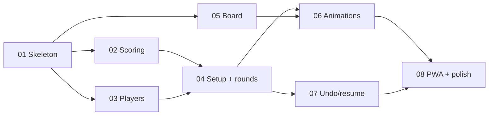

# Hopscore — Plan overview

**Hopscore — Dixit Score Tracker.** A free web score keeper for storytelling card games. It remembers
players and groups, and shows the scores as low-poly bunnies hopping along a garden track.

- Full spec: [spec.md](spec.md)
- Planning ticket: none (personal project, no tracker)
- Stack: TypeScript, Vite, Three.js, Vitest. Static site on GitHub Pages.

## Tasks

| # | Title | What it delivers | Depends on |
|---|---|---|---|
| 01 | [Skeleton and deploy](raw_prompts/01_skeleton_and_deploy.md) | Vite + TS project, Actions, empty page live on Pages | - |
| 02 | [Scoring engine](raw_prompts/02_scoring_engine.md) | Pure scoring (standard + 3-player), rotation, tests | 01 |
| 03 | [Players and groups](raw_prompts/03_players_and_groups.md) | Saved players, colours, groups, safe storage fallback | 01 |
| 04 | [Setup and round entry](raw_prompts/04_setup_and_round_entry.md) | New game, tap-to-vote, review, 2D score list | 02, 03 |
| 05 | [Garden board and bunnies](raw_prompts/05_garden_board_and_bunnies.md) | Three.js scene, code-built bunnies, track, camera | 01 |
| 06 | [Animations](raw_prompts/06_animations.md) | Hops, celebrations, skip, reduced motion | 04, 05 |
| 07 | [Undo, resume, history](raw_prompts/07_undo_resume_history.md) | Undo, autosave, finished-game history | 04 |
| 08 | [PWA and polish](raw_prompts/08_pwa_and_polish.md) | Offline, install, footer disclaimer, perf pass | 06, 07 |

## Dependency graph

## Parallel work

- After 01: tasks 02, 03 and 05 can all run at once.
- After 04: tasks 07 and 06 (once 05 is done) can run at once.
- Critical path: 01 → 02/03 → 04 → 06 → 08.

## Open questions

1. The exact 3-player rules, from a rulebook (affects task 02 only, kept in one place).
