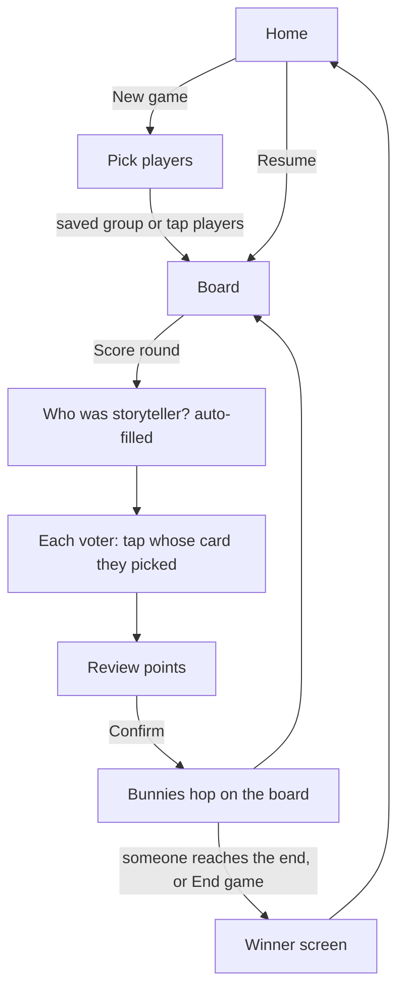

# Hopscore — Spec

**Name:** Hopscore. **Tagline:** "Dixit Score Tracker".

Naming rule: "Hopscore" is the product name everywhere it acts as a name (page title, logo, icon,
home-screen label, repo, domain). "Dixit" only appears in the tagline and description, to say which
game the app works with. The footer carries: "Not affiliated with or endorsed by Libellud. Dixit is
a trademark of Libellud."

## Overview

Hopscore is a free score keeper for storytelling card games, the kind where one player gives a clue,
everyone adds a card, and the others vote on which card was the storyteller's. It runs in the
browser on a phone at the table. Players are shown as cute low-poly bunnies that hop along a garden
track as they score.

It replaces the official companion app, which forgets every player name between games. Hopscore
remembers players and groups, so starting a game takes one tap.

## Why this exists

- The existing app makes you type every name again, every game.
- Score keeping on paper is slow, and people argue about the bonus points.
- A score keeper can be fun to watch. The bunnies hopping is the reward after each round.

## Goals

1. Start a game with saved players in under 10 seconds.
2. Enter a round with a few taps and get the points right every time.
3. Make each round's result fun to watch: bunnies hop, celebrate, sulk.
4. Work offline, load fast on a mid-range phone, cost nothing to host.

## Not in scope (version 1)

- The card game itself: no cards, no card art, no online play.
- Any use of another game's logo, art or board look. "Dixit" appears only in the tagline and
  description, never as the app's name (see the naming rule at the top).
- Accounts, servers, or syncing between devices. Everything stays on the device.
- Support / donation links. Planned for later, see **Later** below.
- 9 or more players.

## Who uses it, and how

One person (the scorekeeper) holds a phone during game night. Sometimes the phone is passed around.
Screens must work one-handed, in portrait, with big tap targets, and in a dim room.

## Main flow

## Features

### 1. Players and groups (saved on the device)

- A player has a name and a bunny colour. Both are remembered.
- Groups: save a set of players as a named group, for example "Friday crew". Starting a new game
  from a group is one tap.
- Recently used players appear first.
- Players can be renamed, recoloured, or deleted.
- Data lives in the browser's local storage. If storage is not available (private mode), the app
  still works for that session and says that names will not be remembered.

### 2. Game setup

- Choose 3 to 6 players from saved players, or add a new one inline. Task 09 raises this to 8,
  since the current edition of the card game is for 3 to 8 players.
- Set the seat order by dragging. The storyteller rotates in this order.
- Choose the track length (default 30).
- For 3 players, the 3-player rules are switched on automatically (see Scoring).

### 3. Entering a round

1. The storyteller is filled in from the rotation. It can be changed.
2. For each other player, tap whose card they voted for. Only valid choices are shown: a player
   cannot vote for their own card.
3. A review screen shows each player's points for the round, with a short reason
   ("found the storyteller: +3", "2 votes on your card: +2").
4. Confirm. The board animates.

Entering votes is all that is needed. The app works out every score from them.

### 4. Scoring rules

Standard rules (4 to 6 players):

| Case | Storyteller | Each other player |
|---|---|---|
| Everyone found the storyteller's card | 0 | 2 |
| Nobody found it | 0 | 2 |
| Some found it | 3 | 3 if they found it, else 0 |

Plus, in every case: each player except the storyteller gets +1 for every vote on their own card.

3-player rules: each non-storyteller puts in 2 cards, so there are more cards to vote on.
Scoring follows the same table. Votes on either of a player's two cards count toward their bonus.
**To verify against a rulebook before this ships**, including whether the bonus has a cap.

The game ends when a bunny reaches the end of the track, or when the scorekeeper taps
"End game" (for example when the deck runs out). Highest score wins. Ties are shared wins.
Scores can go past the track length; the bunny waits on the final stone with its score shown.

The scoring engine is pure logic with no UI, and is fully covered by table-driven tests.

### 5. Undo and resume

- Undo the last round, any number of times. The bunnies hop back.
- The game in progress is saved after every round. Closing the tab and opening it again resumes.
- Finished games are kept in a short history (date, players, final scores).

### 6. The board and the bunnies

- **Bunnies:** original low-poly bunnies, built for this app. One colour per player, name label
  floating above.
- **Track:** a winding path of stepping stones through a small garden, with a numbered stone
  every 5 steps.
- **Hop:** one stone at a time, with squash and stretch and a dust puff on landing. Bunnies move
  one after another in a clear order so nobody misses a move.
- **Big round** (5 or more points): a celebration, for example a spin and a burst of petals.
- **Storyteller scores 0:** ears droop for a moment.
- **Winner:** a victory dance at the finish, other bunnies clap.
- **Camera:** gently follows the action, then settles on a view of the whole track.
- **Skip:** a tap skips the animation to the final positions.
- **Reduced motion:** if the phone asks for less motion, bunnies move without bouncing or effects.

### 7. Look and feel

- Bright, warm, friendly. Works in light and dark rooms.
- Big buttons, readable text, colour is never the only way to tell players apart (names always show).

### 8. Offline and install

- Installable to the home screen (PWA).
- Works with no connection after the first visit.

## Technical direction

- **Stack:** a static web app. TypeScript, built with Vite. Three.js for the 3D board.
  No backend.
- **Bunnies and garden:** built in code from simple shapes (low-poly), so there is no asset
  pipeline and nothing borrowed. Can be swapped for Blender-made glTF models later.
- **Size budget:** first load under about 1 MB compressed on a phone.
- **Performance:** a smooth 60 fps on a mid-range Android phone; fall back to fewer effects if
  frames drop.
- **Tests:** unit tests (Vitest) for scoring, rotation, undo and storage. The board is checked by
  hand in a phone browser.
- **Hosting:** GitHub Pages, deployed by GitHub Actions on every push to `main`.
- **Repo:** private repo on the personal GitHub account; made public if and when it is released.

## What can go wrong

| Problem | What the app does |
|---|---|
| Local storage blocked or full | Keeps working for the session, shows a small notice |
| Saved data from an older version | Migrates it, or keeps players and drops only the broken game |
| Phone too slow for 3D | Lowers effects; a simple 2D track is the last fallback |
| Wrong round entered | Undo |

## Later

- Support link in the footer (provider still to be decided; the footer will read from a small
  config list, and an empty slot is hidden).
- Sound effects.
- Share a picture of the final board.
- A custom domain (check that a "hopscore" domain is free).

## Open questions

1. The exact 3-player rules, from a rulebook.
2. Whether 7 and 8 players use different rules, from a rulebook (task 09).

## Implementation checklist (high level)

1. Project skeleton, deploy pipeline, empty page live on GitHub Pages.
2. Scoring engine with tests.
3. Players, groups, and storage.
4. Game setup and round entry screens (with a plain 2D score list).
5. 3D garden board and bunnies, static.
6. Hop animations and celebrations.
7. Undo, resume, history.
8. PWA, offline, polish, performance pass.
9. Games and groups of up to 8 players.
